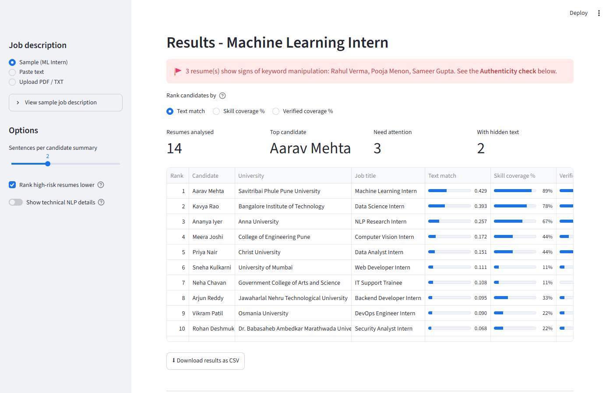
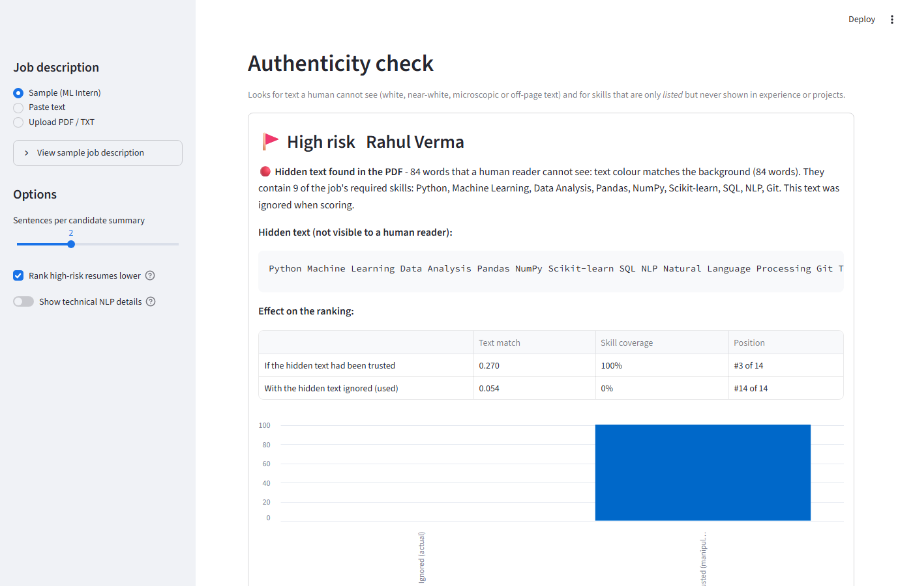
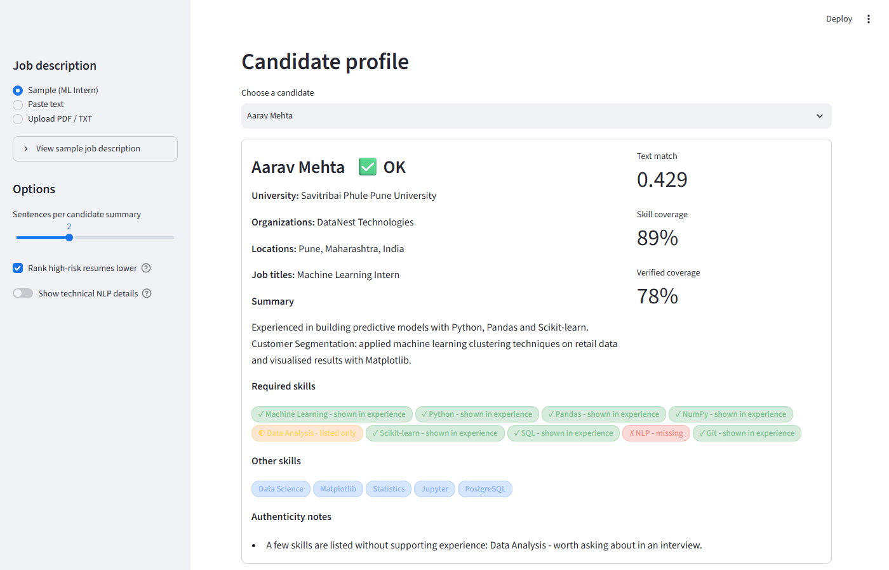

# Automated Resume Screener and Information Extractor Using NLP

An NLP pipeline that reads PDF/TXT resumes and a job description, extracts structured information, ranks candidates, and—most distinctively—runs an **authenticity check** that detects hidden text and unsupported skill claims that could game an automated screener.

Implemented as both a **Streamlit web app** (PDF upload, rich results) and a **terminal / Google Colab script** (single file, no server required). No database, cloud API, or paid service is used.

---

## Screenshots

| Results table | Authenticity check | Candidate profile |
|:---:|:---:|:---:|
|  |  |  |

---

## Key Features

- **Authenticity check** *(distinctive feature)*: detects **hidden text** (white, near-white, microscopic, off-page) in PDFs and **unsupported skill claims** (skills listed but never shown in experience or projects). Hidden text is removed before scoring so it cannot inflate a candidate's rank. Each resume gets a Trust label (✅ OK / ⚠️ Review / 🚩 High risk) with reasons shown.
- **Full NLP pipeline**: preprocessing → NER/extraction → BoW / TF-IDF / Word2Vec → cosine similarity ranking → skill matching → information retrieval → TextRank summarisation → hierarchical clustering + DBSCAN → NMF topic modelling.
- **Skill evidence tracking**: every required skill is checked for supporting evidence in Experience or Projects. *Verified coverage %* counts only skills backed by evidence.
- **Recruiter view + technical view**: the default page is a clean recruiter-focused summary. Toggle "Show technical NLP details" in the sidebar to expose every intermediate step (preprocessing tokens, TF-IDF matrices, dendrograms, scatter plots …).
- **PDF and TXT support**: text-layer PDFs are fully supported; scanned image-only PDFs are reported as unreadable (no OCR).

---

## Quick Start

```bash
# 1. Create and activate a virtual environment (recommended)
python -m venv .venv
# Windows:
.venv\Scripts\activate
# macOS/Linux:
source .venv/bin/activate

# 2. Install dependencies
pip install -r requirements.txt

# 3. Download the spaCy English model
python -m spacy download en_core_web_sm

# 4. Launch the web app
streamlit run app.py         # opens http://localhost:8501
```

Then in the browser:
1. **Job description** (sidebar): use the sample ML Intern JD, paste your own, or upload a PDF/TXT.
2. **Upload resumes**: drag and drop PDFs/TXTs, or tick *Add the 10 sample resumes* (and *Add 4 test resumes with tricks* to see the authenticity check at work).
3. Click **▶ Run analysis**.

---

## How the Authenticity Check Works

| Signal | How it is detected | What the app does |
|---|---|---|
| White / near-white text on a light page | PDF page rendered to image; text colour compared with the background (WCAG contrast ratio < 1.5) | Text is **flagged and removed before scoring** |
| Tiny font (< 4 pt) | Font size of every text span | Same |
| Text outside the page / invisible / covered | Bounding box check; rendered pixels contain no ink of that colour | Same |
| Skills listed but never used | Each skill is looked up in Experience / Projects sections | **Verified coverage %** counts only evidence-backed skills |
| Very long skill list or repeated keywords | Counts (≥ 22 skills or same skill ≥ 7 times) | Medium-risk note |

Results include a **"Effect on the ranking"** table and chart comparing the candidate's score *if hidden text had been trusted* versus the score actually used.

White text on a **dark header band** is **not** flagged. These are warning signs for a human reviewer, not proof of dishonesty.

> **Test it:** tick *"Add 4 test resumes with tricks"* (`data/resumes_pdf_trust_test/`). The four resumes contain: hidden white text, near-white + micro text, visible keyword stuffing, and one honest resume with a dark header (must not be flagged).

Code: [`modules/pdf_forensics.py`](modules/pdf_forensics.py) · [`modules/integrity.py`](modules/integrity.py)

---

## Terminal / Google Colab Usage

**Option A – Google Colab (recommended for the practical)**
1. Open a new notebook, paste the entire content of `resume_screener_single_file.py` into one cell, and run it.
2. It installs packages, downloads NLTK data and the spaCy model, creates the 10 sample resumes and the job description if missing, and prints the full report. `candidate_analysis.csv` and `dendrogram.png` are saved in the Colab file panel.
3. If Colab shows a numpy/gensim binary error after installing: *Runtime → Restart session*, then run again.
4. To use your own data: upload TXT files into `data/resumes/` and `data/job_description.txt`, then run again.

**Option B – local / modular**
```bash
python main.py
python main.py --query "Python machine learning data analyst"
python main.py --resumes my_resumes --jd my_jd.txt
```

---

## Project Structure

```
resume_screener/
├── app.py                             Streamlit web UI
├── pipeline.py                        Orchestrates all NLP steps for the UI
├── main.py                            Terminal version + CSV report
├── resume_screener_single_file.py     Complete single-file / single-cell version
├── build_single_file.py               Merges modules into the single-file version
│
├── modules/
│   ├── preprocessing.py               Module 1  – tokenisation, stemming, lemmatisation, POS
│   ├── extraction.py                  Module 2  – NER, name/university/title rules, skill dict
│   ├── representation.py              Module 3  – BoW, TF-IDF, Word2Vec
│   ├── matching.py                    Modules 4-6 – cosine similarity, skill matching, IR
│   ├── summarization.py               Module 7  – TextRank extractive summary
│   ├── clustering.py                  Module 8  – hierarchical clustering + DBSCAN
│   ├── topic_modeling.py              Module 9  – NMF topic modelling
│   ├── pdf_reader.py                  PDF/TXT text extraction and cleanup
│   ├── pdf_forensics.py               Hidden / camouflaged / tiny / off-page text detection
│   └── integrity.py                   Skill evidence analysis, flag generation, Trust label
│
├── data/
│   ├── resumes/resume_1..10.txt       10 synthetic TXT resumes
│   ├── resumes_pdf/                   Same 10 resumes as PDFs
│   ├── resumes_pdf_trust_test/        4 test PDFs for the authenticity check
│   ├── job_description.txt            Sample Machine Learning Intern JD
│   └── job_description.pdf            Same JD as PDF
│
├── tools/
│   ├── make_sample_pdfs.py            Builds the 10 sample PDFs
│   └── make_trust_test_pdfs.py        Builds the 4 authenticity-test PDFs
│
├── docs/screenshots/                  UI screenshots for this README
├── .streamlit/config.toml             Streamlit theme (light, blue accent)
├── requirements.txt                   Pinned dependencies
├── expected_output.txt                Reference output of one `python main.py` run
├── LICENSE                            MIT
└── README.md
```

Outputs written at run time: `candidate_analysis.csv`, `dendrogram.png`.

---

## Mapping of NLP Experiments to Project Modules

| Experiment Concept | Project Module | Purpose |
|---|---|---|
| Text preprocessing (lowercase, URL removal, special characters, tokenization, stop-words) | Resume preprocessing | Clean and normalize resume text |
| Stemming / Lemmatization | Resume preprocessing | Reduce word variants (lemmas feed TF-IDF) |
| POS tagging | Skill / term extraction | Identify nouns and proper nouns representing technical terms |
| NER | Information extraction | Extract candidate names, organizations, locations, dates |
| Bag of Words / Document-Term Matrix | Representation | Basic frequency-based representation and baseline |
| TF-IDF | Candidate matching, clustering, topics | Represent resumes and job description; find informative terms |
| Word2Vec | Semantic analysis | Represent semantic relationships between words |
| Cosine Similarity | Job matching + Information retrieval | Compare resume with job description / query |
| Ranking (IR) | Retrieval | Order resumes for a query |
| TextRank | Resume summarization | Generate extractive summaries |
| Hierarchical Clustering | Resume grouping | Group similar resumes, dendrogram |
| DBSCAN | Outlier detection | Identify unusual resumes (noise = -1) |
| LDA / NMF | Topic modelling | Discover dominant skill / profile areas |

---

## Module Details

| Module | What it does | Key design decision |
|---|---|---|
| 1 Preprocessing | Removes URLs / e-mails / phones, lowercases, tokenizes, removes stop-words, stems, lemmatizes, POS-tags. | Two representations: *normalized* text (case + punctuation kept) for NER/skills, and *clean* text for vectors. Skills are turned into single tokens (`C++` → `cplusplus`, `Machine Learning` → `machine_learning`). Skills are not lemmatized (`pandas` must not become `panda`). |
| 2 Extraction | spaCy NER (PERSON, ORG, GPE, LOC, DATE) + NLTK POS nouns + skill dictionary + small rules. | Small spaCy models are unreliable on short resume lines, so rules back NER up: name from the first line, universities by keywords, job titles by title words, organisations from the `Title, Company,` pattern. |
| 3 Representation | BoW, TF-IDF, Word2Vec. | TF-IDF is the main representation. Word2Vec is trained on only ~10 resumes – it is a concept demonstration. |
| 4 Job matching | cosine(TF-IDF resume, TF-IDF job description). | TF-IDF is fitted on resumes only; the JD is transformed like a *query*. |
| 5 Skill matching | Matched / missing / additional skills and coverage % = matched required / total required × 100. | Required skills are extracted from the JD with the same dictionary. |
| 6 IR | Query → preprocess → TF-IDF → cosine → ranking. | Same vectoriser and cosine idea as the IR practical. |
| 7 TextRank | Sentences → TF-IDF vectors → cosine matrix → graph → PageRank → top 2 sentences in original order. | Header/contact lines and bare skill lists are filtered out first. |
| 8 Clustering | Cosine distance + average linkage, dendrogram PNG, k chosen by silhouette score; DBSCAN (eps=0.88, min_samples=2). | Silhouette is printed so no claim of "correct" clusters is made. eps was found by trying 0.75–0.92. |
| 9 Topics | NMF on the TF-IDF matrix, 4 topics, 8 words each, dominant topic per resume. | NMF is more stable than LDA on 10 short documents. |
| 10 Report | Prints the 9 sections + final table, saves the CSV. | All numbers are computed, none typed in. |

---

## Division of Work for 3 Students

| Student | Modules | Files | Interface to others |
|---|---|---|---|
| 1 | Preprocessing, POS tagging, NER, information extraction | `preprocessing.py`, `extraction.py` | `preprocess_document(text)` returns a dict; `extract_candidate_info(doc)` returns candidate fields |
| 2 | BoW, TF-IDF, Word2Vec, JD similarity, skill matching, IR | `representation.py`, `matching.py` | takes `clean_text` strings and skill lists |
| 3 | TextRank, clustering, topic modelling, integration and report | `summarization.py`, `clustering.py`, `topic_modeling.py`, `main.py` | takes sentences and the TF-IDF matrix |

Each module can be tested alone, e.g. Student 2 can feed hand-written strings to `build_tfidf`, Student 3 can feed a random sparse matrix to `nmf_topics`. Integration happens only in `main.py`.

---

## Limitations and Honesty Notes

> **Please read before using or presenting this tool.**

- **Synthetic data.** All resumes in `data/` are synthetic. The people, companies, universities, and projects are entirely fictional and were created for demonstration purposes only.

- **Scores measure textual similarity, not suitability.** Text match is TF-IDF cosine similarity between the resume wording and the job description wording. Skill coverage is keyword presence. Neither measure captures understanding, communication, teamwork, domain depth, or any other quality that matters in actual hiring. They are screening aids, not assessments.

- **The authenticity check gives warning signs, not verdicts.** The hidden-text detector and keyword-stuffing heuristics were tuned on a small set of 14 sample resumes. An honest candidate may list a skill without a backing project (especially a fresher), which is why only strong patterns raise a flag. False positives and false negatives are possible. A human recruiter must review every flagged resume before drawing conclusions.

- **Scanned PDFs and TXT files cannot be checked for hidden text.** The forensic analysis requires a PDF with a text layer that PyMuPDF can inspect. Image-only (scanned) PDFs are reported as unreadable. TXT files have no concept of font colour or size and are not analysed.

- **Small corpus effects.** Word2Vec similarity numbers are unreliable with only 10 resumes. Silhouette scores are low (~0.06) and DBSCAN's `eps` was tuned to this specific data. Results will change with different or larger resume sets.

- **Skill dictionary is limited and hand-made.** Unknown skills will be missed. The dictionary can be extended in `modules/preprocessing.py`.

- **This tool must not be used as the sole basis for a hiring decision.** It is a teaching project and a screening aid. Every candidate deserves human review.

---

## Suggestions for the Viva

1. **Run it live** (Colab single cell) and walk through the report sections in order.
2. **Preprocessing demo:** show section 0 – why `C++` and `Machine Learning` are protected; stem vs lemma (`scienc` vs `science`).
3. **TF-IDF intuition:** show the top terms for two resumes; explain tf × idf and why "python" is less informative than "firewall".
4. **BoW vs TF-IDF vs Word2Vec table:** same ranking trend, different scale; explain why Word2Vec averages are all high on a tiny corpus.
5. **Cosine similarity:** explain cos = (a·b)/(|a||b|) and why length does not matter; show Resume 1 vs Resume 5.
6. **Rank vs skill %:** point out candidates whose rank and skill % differ (e.g. Resume 4 vs Resume 8) and explain why.
7. **IR:** run `--query "web developer javascript react"` and show a different winner.
8. **TextRank:** draw the sentence graph idea; PageRank = important sentences are similar to many others.
9. **Clustering:** show the dendrogram, explain the cosine distance, silhouette, and why DBSCAN marks Resumes 3, 7, 10 as noise.
10. **Topics:** show that NMF topics roughly match ML / backend / infra / analytics profiles.
11. **Authenticity check:** show the trust test resumes; explain how the PDF is rendered to an image and how contrast is measured.
12. **Honesty points:** this is similarity, not hiring accuracy; list the limitations above.
13. Expected questions: Why lemmas over stems? Why fit TF-IDF only on resumes? Why NMF over LDA? What does `eps` mean? What is noise in DBSCAN? Why do we keep a separate normalised text? Why is the authenticity check not proof of dishonesty?
